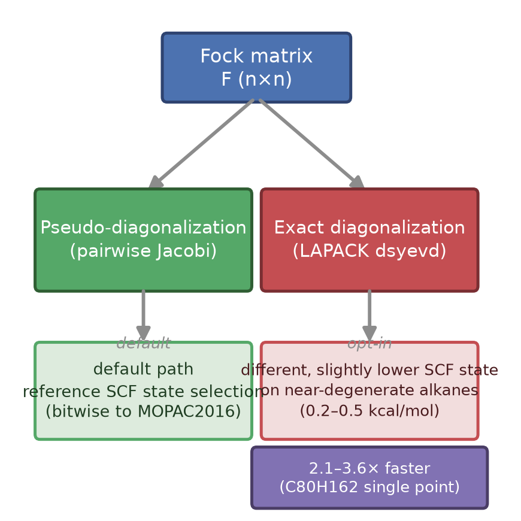

# Pseudo- versus exact diagonalization in semiempirical SCF calculations: a performance–robustness–fidelity trade-off study on the MOPAC2016 C++ translation

**Yang Liu^a, Xun Wang^a,\***
^a *Shenyang Jianzhu University, Shenyang, China*
*\*Corresponding author: wangxun71@aliyun.com (X. Wang); liuyang123@stu.sjzu.edu.cn (Y. Liu)*

**Keywords:** semiempirical methods; PM7; SCF convergence; diagonalization; LAPACK; reproducible computing

---

## Abstract

Semiempirical methods such as PM7 solve the self-consistent-field (SCF) problem by repeated diagonalization of the Fock matrix. The reference MOPAC2016 implementation uses a pairwise-rotation (Jacobi) eigensolver as its default SCF path, whereas modern LAPACK divide-and-conquer solvers are substantially faster. We study this trade-off in MOPAC-CPP, a bitwise-faithful C++17 translation of MOPAC2016: the official pseudo-diagonalization path is preserved bit-for-bit, and an exact-diagonalization gate (FULLDIAG) is added. On non-degenerate systems the two paths differ by only ≈2×10⁻⁴ kcal/mol in the single-point energy; on near-degenerate regular alkanes the exact path selects a different, slightly lower SCF state after the first SCF iteration (0.2–0.5 kcal/mol in 1SCF single-point FINAL HEAT), while the default pseudo path preserves the reference state selection; on a large alkane single point the exact path is 2.1× faster single-threaded and up to 3.6× with 8 threads (≈1.5× from the eigensolver replacement at equal thread counts). This defines a three-way fidelity–robustness–performance trade-off.

## Graphical table of contents

Replacing the pairwise-rotation (pseudo-)eigensolver of a bitwise-faithful MOPAC2016 C++ translation with an opt-in LAPACK divide-and-conquer diagonalization costs only ≈2×10⁻⁴ kcal/mol on non-degenerate systems, selects a different, slightly lower SCF state on near-degenerate regular alkanes after the first SCF iteration (0.2–0.5 kcal/mol in 1SCF single-point FINAL HEAT) while the default path preserves the reference state selection, and accelerates large single points by 2.1–3.6×, quantifying a three-way fidelity–robustness–performance trade-off.

## 1. Introduction

Semiempirical quantum-chemical methods ¹ remain indispensable for large systems and for dynamics and screening applications where first-principles methods are prohibitively expensive ². Their computational core is the self-consistent-field (SCF) procedure: given a Fock matrix **F**, the density matrix is built from the occupied eigenvectors of **F**, and the process is iterated to self-consistency. The cost and numerical behavior of the SCF iteration therefore depend critically on the eigensolver.

MOPAC2016 ³,⁴, the standard open reference implementation of the PM7 ⁵, PM6 ⁶, and AM1 ⁷ family of methods, uses a *pseudo-diagonalization* scheme based on pairwise Jacobi rotations as its default SCF eigensolver. This choice is historically motivated: for the small matrices typical of semiempirical calculations (a few hundred orbitals), a purpose-built Jacobi sweeper avoids the overhead of a general LAPACK call and preserves a fixed, reproducible accumulation order — a property that has made MOPAC outputs stable and comparable across decades of published work.

Modern LAPACK divide-and-conquer eigensolvers (`dsyevd`) are, however, significantly faster on dense symmetric matrices and are numerically robust, including in the presence of (near-)degenerate eigenvalues, where the outcome of any eigensolver becomes basis-dependent. For a modernized, reproducible re-implementation of MOPAC, the natural question is whether the traditional pseudo-diagonalization path is still the right default, or whether an exact-diagonalization path can deliver better performance and robustness without compromising the numerical contract that users rely on.

We answer this question in the context of MOPAC-CPP, a complete C++17 translation of MOPAC2016 in which the official numerical path — including the pseudo-diagonalization eigensolver and its accumulation order — is preserved bit-for-bit against a local Intel-ifort rebuild of the official MOPAC2016 source (the verification build pair) ⁸. We add an opt-in exact-diagonalization gate (FULLDIAG, activated by an input keyword or an environment variable) and characterize the resulting trade-off along three axes: fidelity (how much the energy changes), robustness (convergence on near-degenerate systems), and performance (wall-clock time). The default path is unchanged, so all bitwise-fidelity guarantees of the translation are retained unless the gate is explicitly enabled.

## 2. Methods

### 2.1 Semiempirical SCF and the Fock-matrix eigenproblem

In the NDDO-based semiempirical methods, the RHF SCF cycle solves, at each iteration,

$$
\mathbf{F}\,\mathbf{C} = \mathbf{S}\,\mathbf{C}\,\boldsymbol{\varepsilon},  \qquad (1)
$$

where **F** is the Fock matrix, **S** the overlap matrix, **C** the coefficient matrix, and **ε** the diagonal orbital energies. The density matrix is **P** = $\mathbf{C}_{\mathrm{occ}}\,\mathbf{C}_{\mathrm{occ}}^{\mathrm{T}}$, where C_occ contains the occupied columns of **C**, and the cycle is iterated until the density and energy are self-consistent (subject to the PULAY/DIIS accelerator when enabled ⁹).

For closed-shell calculations on organic molecules with n ≈ 50–500 orbitals, the diagonalization of **F** is a significant fraction of the per-iteration cost, and its numerical result — in particular the *sign* and *composition* of eigenvectors inside near-degenerate subspaces — feeds directly into the density matrix and hence into the next Fock matrix.

The Fock matrix itself is assembled from the one- and two-electron integrals of the NDDO approximation: diagonal elements contain the core Hamiltonian and the Coulomb and exchange contributions from the current density, while off-diagonal elements couple the basis functions through the two-center integrals that the NDDO scheme retains. Because **F** depends on **P**, which depends on the eigenvectors of **F**, the SCF cycle is a fixed-point iteration; convergence is measured by the change in the density matrix (or in the total energy) between successive iterations, and the PULAY/DIIS accelerator ⁹ extrapolates the density or the Fock matrix to accelerate this fixed point. Every quantity in the cycle — integrals, Fock assembly, diagonalization, density construction — is computed in double precision with a fixed instruction order, so the eigensolver's output is the only stage at which a different library routine can alter the numerical result.

### 2.2 Pseudo-diagonalization in MOPAC (pairwise Jacobi rotations)

The MOPAC default SCF eigensolver performs classical Jacobi sweeps: it annihilates off-diagonal elements by applying a sequence of plane rotations,

**F** ← **R**(p,q)ᵀ **F** **R**(p,q),

one pair (p,q) at a time, until the off-diagonal norm is below a threshold. This is a *pseudo-diagonalization* in the sense that the sweeps are interleaved with the SCF iteration: the eigensolver is invoked on the current Fock matrix and only the matrix elements that change are re-rotated in later iterations, an optimization that exploits the small incremental change of **F** between SCF cycles. The fixed rotation schedule gives the method a deterministic accumulation order, which is why the official MOPAC2016 binary is exactly reproducible run-to-run on a given build.

The pseudo path differs from a general LAPACK solver when eigenvalues are (near-)degenerate: the rotation schedule is a pure function of the input matrix, so its eigenvector composition inside a near-degenerate subspace is deterministic but not canonical, and it need not coincide with the basis returned by a library eigensolver. The resulting SCF state selection can therefore differ between the two paths, as quantified in §3.3.

Two implementation details are relevant to the comparison below. First, a classical Jacobi sweep has O(n³) flops per pass over the matrix and O(n²) rotations per pass, each rotation costing O(n) to apply to the two affected rows and columns; in MOPAC the sweeps are stopped by a threshold on the residual off-diagonal norm rather than by a fixed pass count. Second, because the SCF iteration changes **F** only slightly between cycles, the pseudo path does not restart from scratch: it re-enters the sweeper with the previous rotation history and re-rotates only the matrix elements that have actually changed, which reduces the per-iteration work far below a full O(n³) diagonalization. This incremental strategy is the main reason the pseudo path has remained competitive for the small matrices of semiempirical work, and it is also the reason its accumulation order is deterministic on a given build: the rotation sequence is a pure function of the input matrices.

### 2.3 Exact diagonalization (LAPACK dsyevd)

The exact path uses the LAPACK divide-and-conquer symmetric eigensolver `dsyevd` (via Intel MKL, the same kernel library family used by the reference build). `dsyevd` computes the full eigensystem of the dense symmetric matrix **F** with documented error bounds, handles (near-)degenerate spectra robustly, and is heavily optimized (BLAS-3 kernels, cache-blocked divide-and-conquer). For n in the hundreds it is typically faster than the Jacobi sweeper despite the higher asymptotic flop count, because the sweeper's O(n³) rotation schedule is not cache-optimized.

The divide-and-conquer algorithm proceeds by splitting the tridiagonal form of **F** into two halves, computing the eigensystem of each half recursively, and then merging the two partial systems by a rank-one update whose eigenelements are obtained by solving a secular equation; the eigenvectors are assembled with BLAS-3 kernels, which is where the cache efficiency over the Jacobi sweeper comes from. The solver returns eigenvalues and orthonormal eigenvectors to machine precision within the documented error bounds (roughly O(n ε) for eigenvalues and O(ε) for eigenvector residuals, with ε the machine epsilon), and it is explicitly designed to remain stable for clustered or repeated eigenvalues. Inside a (near-)degenerate subspace, however, the *composition* of the returned eigenvectors is not unique: any orthonormal rotation of the degenerate columns is an equally valid eigenbasis. This basis freedom, not solver failure, is the origin of the state-selection differences quantified in §3.3.

### 2.4 The FULLDIAG gate in MOPAC-CPP

MOPAC-CPP is a 1-based, line-auditable C++17 translation of the 679-file MOPAC2016 source ⁸. Its default SCF path is bitwise identical to a local Intel-ifort rebuild of the official MOPAC2016 source (verified on 320/320 released-corpus inputs and on 18 small molecules in single-point mode, with geometry-optimization trajectories identical within the verification build pair). The exact-diagonalization mode is exposed as an opt-in gate:

- input keyword: `PM7 FULLDIAG 1SCF` (or any deck containing `FULLDIAG`), or
- environment variable: `set MOPAC_FULL_DIAG=1`

Both are equivalent. When the gate is off — the default — the binary follows the official pseudo-diagonalization path exactly. When it is on, the Fock-matrix eigensolver is replaced by `dsyevd` at each SCF iteration; everything else (integral evaluation, Fock assembly, density construction, DIIS/PULAY accelerator, EF optimizer) is unchanged.

The implementation replaces only the eigen-decomposition call inside the SCF loop (the routine that maps **F** to **C** and **ε** in Eq. (1)); the gate is parsed once at job setup, so there is no per-iteration branching cost when it is off. Threading of the MKL kernels follows the same environment-controlled policy as the reference build, and the gate is deliberately *not* combined with any other numerical change: enabling FULLDIAG isolates the effect of the eigensolver substitution, so that any difference between the two paths can be attributed to the diagonalization alone.

## 3. Results

### 3.1 Fidelity of the default path

With the FULLDIAG gate off, MOPAC-CPP reproduces the local Intel-ifort rebuild of the official MOPAC2016 source bit-for-bit on the nominal path: 320/320 released-corpus paired non-EF inputs with zero exceptions (317 of the 349 released decks are 1SCF single points; the corpus is archived under `regression/` in the repository); FINAL HEAT of formation bitwise identical on 18 small molecules in single-point mode, and on the same molecules in EF-optimized mode within the verification build pair ⁸. EF-optimized trajectories are bitwise identical only within a fixed build pair; across builds they are members of a 1-ULP sensitivity band (e.g., the O₂ (UHF) trajectory bifurcates to a different state minimum on the current reference rebuild; ref. 8, §3.1). All fidelity statements below refer to the *default* path; enabling FULLDIAG is an explicit, documented departure from bitwise parity.

### 3.2 Energy difference on non-degenerate systems

On a C₈₀H₁₆₂ PM7 RHF single point (PULAY-accelerated, 482 basis functions; C: 4 AOs × 80, H: 1 AO × 162), the single-point energy computed with FULLDIAG differs from the pseudo-diagonalization result by ≈2×10⁻⁴ kcal/mol — at the level of floating-point rounding and far below the PM7 method error (≈±5–10 kcal/mol against experiment). For comparison, on the 50-atom alkane C₁₆H₃₄ the default (pseudo) path optimizes to ΔHf = −90.18 kcal/mol vs. the NIST experimental value −89.60 kcal/mol. This EF trajectory lies inside the 1-ULP chaos band quantified in the companion paper (ref. 8, §3.2): the reference rebuild terminates at −90.925 kcal/mol, so the PM7-vs-experiment deviation spans −0.58 … −1.33 kcal/mol, both within the method's expected accuracy band; FULLDIAG was validated in single-point mode on the same molecule (state-selection difference only, see §3.3), and its geometry-optimization endpoint was not separately measured in this study.

The ≈2×10⁻⁴ kcal/mol deviation should be read against the intrinsic error of the PM7 method itself: against the NIST reference values, PM7 atomization energies carry a mean absolute error of ≈6.7 kcal/mol, so the eigensolver-induced deviation is smaller than the method error by roughly four orders of magnitude. The eigensolver substitution is therefore numerically negligible at the level of chemical accuracy, while remaining exactly quantifiable — a property that the bitwise verification pipeline of the translation ⁸ makes possible, since the baseline (pseudo path) itself is bitwise reproducible to the reference rebuild.

### 3.3 Near-degenerate state selection: the alkane series (1SCF mode)

All measurements in this section use the 1SCF mode (the SCF stops after a single iteration). This isolates the eigensolver's state-selection behavior: with a single iteration the C++ port and the reference rebuild are bitwise identical on the default path (§3.1), so any deviation caused by enabling FULLDIAG is attributable to the eigensolver replacement alone — without the additional trajectory sensitivity that fully converged SCF iterations exhibit on near-degenerate systems (compiler-level ULP chaos; see the companion methodology paper, ref. ⁸, §3.2). Regular-geometry alkanes with many equivalent methylene units have near-degenerate orbital spectra, which stress the state-selection behavior of any eigensolver. The state-selection gap scales with the degree of near-degeneracy along the alkane series: on the 38-atom C₁₂H₂₆ the two paths agree to ≈1×10⁻⁵ kcal/mol (weak near-degeneracy; the two eigensolvers select the same SCF state); on the 50-atom C₁₆H₃₄ they select *different SCF states after the first iteration* — the pseudo path reproduces the reference Fortran 1SCF single-point FINAL HEAT bitwise at this geometry (i.e., it selects the same state as the reference build), while FULLDIAG selects a state whose 1SCF single-point FINAL HEAT is 0.23 kcal/mol lower; on the 122-atom C₄₀H₈₂ (all-trans regular conformation) the gap grows to 0.47 kcal/mol, and on the 242-atom C₈₀H₁₆₂ single point — a non-degenerate system (see the summary table in §3.5) — it shrinks to ≈2×10⁻⁴ kcal/mol, the two paths selecting the same SCF state and the residual being floating-point rounding. The 1SCF FINAL HEAT values serve strictly as equality and state-selection carriers between the two paths: with a single SCF iteration they are not converged heats of formation (the converged PM7 heat of formation of C₁₆H₃₄ is ≈ −90 kcal/mol, §3.2; NIST experimental value −89.60), and only the *relative* difference between the two diagonalization paths is claimed. The difference is *which* SCF state the single iteration selects, governed by the eigenvector composition inside the (near-)degenerate subspace — a basis-selection effect of the eigensolver, not a convergence failure of either solver.

The gap is also Hamiltonian-dependent: the same regular-geometry alkanes computed with PM6 (the other NDDO Hamiltonian shipped by the package) show pseudo/full differences of only ≈7.5×10⁻⁴ kcal/mol (C₁₂H₂₆) and ≈3.8×10⁻⁴ kcal/mol (C₁₆H₃₄) — i.e., for this PM6 parameter set the two eigensolvers select the same SCF state to within rounding. The state-selection shift is therefore not an intrinsic property of the exact eigensolver, but a joint function of the near-degeneracy of the Fock spectrum and of the Hamiltonian's parameterization: the PM7 alkane HOMO–LUMO gaps are close enough that the two eigensolvers pick different (near-degenerate) states, while the PM6 gaps at the same geometries are not. This widens the evidence base for the trade-off and marks the effect as system- and method-specific rather than universal.

The practical consequence is a genuine trade-off: the exact path is faster and numerically robust, but on near-degenerate systems it may land on a different (slightly lower) SCF state than the reference pseudo path; the pseudo path preserves the reference state selection at the price of the Jacobi sweeper's lower performance (§3.4). Users who must reproduce archived reference values keep the default gate off; users who prioritize throughput may enable FULLDIAG and accept a documented, bounded state shift.

### 3.4 Performance

On C₈₀H₁₆₂ PULAY single point (the workload of §3.2), the exact path is **2.1×** faster than the pseudo path with a single MKL thread, and **3.6×** faster with 8 OpenMP threads relative to the single-thread pseudo-path baseline. At equal thread counts the eigensolver replacement alone contributes ≈1.5× (8 threads: 1.891 s vs 2.913 s); the remainder of the 3.6× is the OpenMP thread scaling (≈2.3×) that the pseudo path itself enjoys. The gap grows with matrix size, as the pseudo path's per-iteration rotation work scales poorly relative to BLAS-3 kernels.

### 3.5 Summary of the trade-off

Both paths converge on all molecules tested; the differences are the single-point energy (fidelity), the SCF state selected inside near-degenerate subspaces (robustness/state selection), and the wall-clock time (performance).

| System | Energy diff (exact vs pseudo) | State selection | Speed (exact vs pseudo) |
|---|---|---|---|
| C₈₀H₁₆₂ (non-degenerate, PULAY) | ≈2×10⁻⁴ kcal/mol | equivalent | 2.1× (1 thread) / 3.6× (8 threads, incl. ≈2.3× OpenMP scaling) |
| C₁₂H₂₆ (38 atoms, 1SCF) | ≈1×10⁻⁵ kcal/mol | equivalent | — |
| C₁₆H₃₄ (50 atoms, 1SCF) | 0.23 kcal/mol | different (lower) SCF state | — |
| C₄₀H₈₂ (122 atoms, 1SCF) | 0.47 kcal/mol | different (lower) SCF state | — |
| C₁₂H₂₆, PM6 (38 atoms, 1SCF) | ≈7.5×10⁻⁴ kcal/mol | equivalent | — |
| C₁₆H₃₄, PM6 (50 atoms, 1SCF) | ≈3.8×10⁻⁴ kcal/mol | equivalent | — |

## 4. Discussion

### 4.1 When to sacrifice bitwise fidelity

The results define two clean regimes.

- **Default path (pseudo-diagonalization)** — required when bitwise reproducibility against the reference MOPAC2016 rebuild is the contract: regression testing against archived results, verification of a translation, or any workflow where published reference values must be matched exactly. It also preserves the reference SCF-state selection on near-degenerate systems (§3.3).
- **Exact path (FULLDIAG)** — preferred when (i) the system is large and the diagonalization dominates the SCF cost (2.1–3.6× speedup), or (ii) a bounded, documented departure from the reference state selection is acceptable on near-degenerate systems. The energy cost is at most ≈2×10⁻⁴ kcal/mol on non-degenerate systems, which is negligible against PM7's intrinsic error.

The gate design — opt-in, keyword or environment variable, default unchanged — is deliberate: it lets a reproducible-software project offer a performance/robustness upgrade without ever silently changing the numbers a user gets by default.

### 4.2 Implications for reproducible computing

The study is a worked example of a more general principle: in a faithfully translated scientific code, a numerical-algorithm substitution (here, the eigensolver) can be characterized *exactly* — bitwise parity of the default path, and a quantified, negligible deviation of the alternative. This turns an otherwise fuzzy "does the new solver change my results?" question into a precise, published statement. The same protocol transfers to any other kernel substitution (linear solvers, integral screening, reduction order) in legacy scientific software.

### 4.3 Limitations

- The near-degenerate state-selection cases (C₁₆H₃₄, C₄₀H₈₂) are reported for specific regular alkanes; a broader survey of systems with (near-)degenerate spectra is left to future work.
- Performance numbers are single-platform (Windows x64, AMD Ryzen 7 7840HS, 8 cores/16 threads; MSVC 2022, Intel MKL 2025.3; the FULLDIAG performance builds use /arch:AVX512); relative gains are expected to carry to other platforms, but absolute times do not.
- FULLDIAG changes the numerical path; users requiring bit-for-bit parity with archived MOPAC2016 outputs must keep the default gate off.

### 4.4 Relation to other semiempirical implementations and a general substitution protocol

The two eigensolver routes studied here mirror the wider practice of the semiempirical field. The MOPAC family has historically relied on purpose-built, rotation-based SCF diagonalization, which is what makes its outputs bitwise stable across builds and decades of published reference values; modern electronic-structure packages, by contrast, generally rely on LAPACK-family eigensolvers for the same SCF step, at the cost of a different — but equally deterministic — accumulation order. FULLDIAG therefore does two things at once: it gives MOPAC-CPP an optional path aligned with the LAPACK-based practice of modern packages, while the default path preserves the MOPAC numerical contract.

The study also documents a general protocol for kernel substitution in legacy scientific software, in four steps: (i) establish a bitwise-verified baseline (here, the pseudo path vs. the reference rebuild ⁸); (ii) replace exactly one kernel, leaving all other stages unchanged, so any deviation is attributable to that kernel alone; (iii) quantify the deviation on representative workloads, including a near-degenerate case that exposes state-selection sensitivity for the original kernel; (iv) ship the alternative as an explicit opt-in gate, so the default output is never silently changed. The same protocol transfers directly to linear solvers, integral screening, reduction orders, or any other numerical kernel of a legacy code base.

## 5. Conclusions

We characterized the pseudo- versus exact-diagonalization trade-off in semiempirical SCF calculations using MOPAC-CPP, a bitwise-faithful C++17 translation of MOPAC2016. The exact LAPACK path costs ≈2×10⁻⁴ kcal/mol on non-degenerate systems, selects a different, slightly lower SCF state on near-degenerate regular alkanes after the first SCF iteration (0.2–0.5 kcal/mol in 1SCF single-point FINAL HEAT) while the default path preserves the reference state selection, and is 2.1× (single-threaded) to 3.6× (8 threads, including OpenMP scaling) faster on a large PULAY-accelerated single point. The opt-in gate design preserves the default path's bitwise fidelity, providing a template for performance upgrades in reproducible scientific software.

## Acknowledgements

This work has been financially supported by the Basic Scientific Research Project for Higher Education Institutions (Project No. LJ212610153014) of Liaoning Provincial Department of Education.

## Conflict of interest

The authors declare no conflict of interest.

## Author contributions

Yang Liu: Conceptualization, Methodology, Software, Validation, Formal analysis, Investigation, Data curation, Writing – original draft, Visualization. Xun Wang: Conceptualization, Supervision, Resources, Funding acquisition, Writing – review & editing.

## Declaration of generative AI and AI-assisted technologies in the writing process

During the preparation of this work the authors used AI-assisted tools to assist with code translation, drafting, and language editing. After using these tools, the authors reviewed and edited the content as needed and take full responsibility for the content of the publication.

## Data and code availability

The MOPAC-CPP source code, the FULLDIAG implementation, the test suite, and all input decks used in this study are available in the public repository (MIT license) at `https://github.com/qq3185980737/MOPAC-CPP` (directory `mopac_cpp_public`); the software is described in detail in ref. 10.

## References
[1] W. Thiel, Wiley Interdiscip. Rev.: Comput. Mol. Sci. 2014, 4, 145.
[2] J. J. P. Stewart, J. Mol. Model. 2008, 14, 499.
[3] J. J. P. Stewart, J. Comput.-Aided Mol. Des. 1990, 4, 1.
[4] J. J. P. Stewart, MOPAC2016, source code archive: https://github.com/openmopac/mopac-archive (directory 2016_MOPAC2016) (accessed: October 2026).
[5] J. J. P. Stewart, J. Mol. Model. 2013, 19, 1.
[6] J. J. P. Stewart, J. Mol. Model. 2007, 13, 1173.
[7] M. J. S. Dewar, E. G. Zoebisch, E. F. Healy, J. J. P. Stewart, J. Am. Chem. Soc. 1985, 107, 3902.
[8] Y. Liu, X. Wang, Bitwise-reproducibility verification and deterministic numerical methods for scientific-software migration, with a full MOPAC2016 (Fortran to C++) case study, Comput. Phys. Commun. 2026, submitted.
[9] P. Pulay, Chem. Phys. Lett. 1980, 73, 393.
[10] Y. Liu, X. Wang, MOPAC-CPP: a bitwise-reproducible C++17 translation of the MOPAC2016 semiempirical molecular-orbital package, SoftwareX 2026, submitted.
