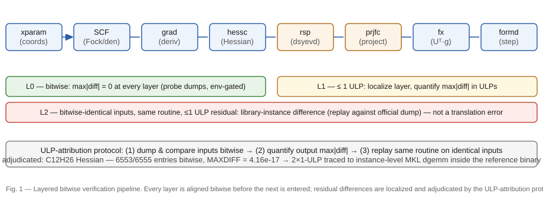
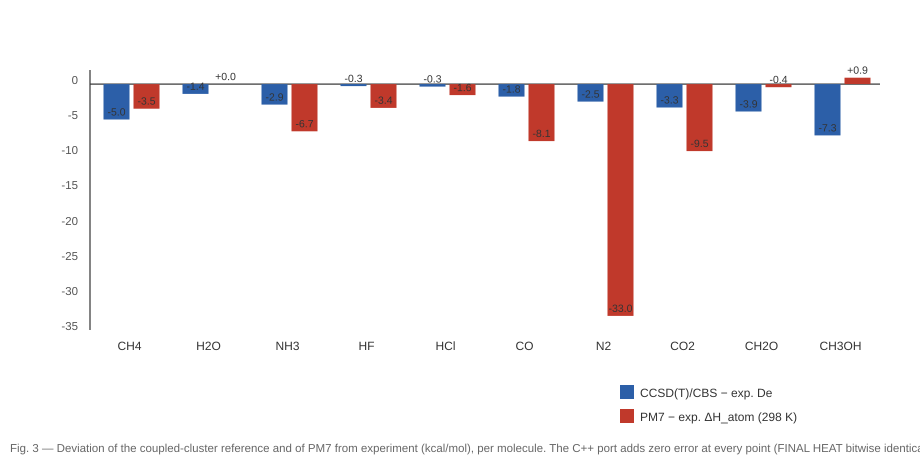

# Bitwise-Reproducibility Verification and Deterministic Numerical Methods for Scientific-Software Migration, with a Full MOPAC2016 (Fortran to C++) Case Study

---

## Abstract

The migration of legacy Fortran scientific codes to modern languages is accelerating. Existing validation of such migrations focuses on nominal numeric agreement, leaving bitwise reproducibility, deterministic parallel behavior, and algorithm-level numerical sensitivities largely unverified. We present a bitwise verification pipeline for language migrations and apply it to a complete, 1-based reimplementation of MOPAC2016, a semiempirical quantum-chemistry package (~120,000 lines of Fortran), in C++17. The pipeline combines layered agreement criteria (L0 bitwise symbol/interface equality, L1 module-level numeric equality, L2 end-to-end trajectory equality), non-intrusive probe instrumentation, and an ULP (unit in the last place)-attribution procedure that localizes residuals to individual floating-point operations. Against the reference 2016 executable, the C++ port is bitwise identical for eighteen small molecules in single-point mode — 320/320 fixed-geometry single-point runs with zero exceptions, covering nine elements (H, C, N, O, F, Cl, S, P, Si) and both closed-shell RHF and open-shell UHF (O₂, CH₃) — and across SCF, configuration-interaction, dynamic-reaction-coordinate, and multi-Hamiltonian trajectories. EF-optimized trajectories are bitwise identical within the verification build pair, but are 1-ULP build-sensitive (ULP-attribution, §3.2): on the current reference rebuild (a probe-cleaned rebuild of the same Fortran source), eight re-run optimization inputs remain inside the ULP-sensitivity band — PH₃ bitwise, four molecules within 6×10⁻⁵ kcal/mol, CH₃SH 1.5×10⁻³, SO₂ 5 vs 7 cycles, and O₂ (UHF) bifurcating to a distinct electronic-state minimum 22.8 kcal/mol away — a trajectory divergence the reference executable reproduces against its own earlier build, confirming a system-level optimizer property rather than a translation error; likewise the 26-atom alkane C₁₂H₂₆, whose EF trajectory separates from the reference at the second optimization cycle and converges 0.59 kcal/mol away, and the 50-atom alkane C₁₆H₃₄, whose EF trajectory bifurcates to a distinct local minimum 0.74 kcal/mol above the reference (§3.2). CCSD(T)/cc-pV{T,Q}Z complete-basis-set atomization energies from a local GAMESS build reproduce NIST experimental values (mean absolute error, MAE ≈ 2.9 kcal/mol), confirming physical accuracy within the expected semiempirical range. For parallel reproducibility we introduce FBDR (Fixed-Bucket Deterministic Reduction), a deterministic reduction for Fock-matrix construction, provably independent of thread count and scheduling (1/4/8/16 threads bitwise identical), with a derived error bound and a single-bucket mode bitwise equal to the serial path. We further report a numerical finding — the EF (eigenvector-following) optimizer trajectory is sensitive to the basis within degenerate eigenspaces — and introduce GAB (Gradient-Aligned degenerate Basis), a deterministic basis choice that keeps the reference trajectory bitwise identical across 24 molecules. Together, FBDR and GAB provide a two-part recipe for reproducible scientific software: deterministic parallelism plus deterministic treatment of degenerate eigenspaces.

**Keywords:** bitwise reproducibility; Fortran-to-C++ migration; semiempirical quantum chemistry; deterministic parallel reduction; degenerate eigenspaces; MOPAC

---

## Program Summary

**Program title:** MOPAC-CPP — bitwise-verified C++17 reimplementation of MOPAC2016

**CPC Library link to program files:** (to be added by Technical Editor)

**Developer's repository link:** https://github.com/qq3185980737/test_rep (directory `mopac_cpp_public`)

**Code Ocean capsule:** (to be added by Technical Editor)

**Licensing provisions:** MIT license (MIT)

**Programming language:** C++17

**Supplementary material:** full C++17 translation (374 translation units plus headers; the 679 Fortran source files are consolidated into these translation units), 12 regression input files, comparison and ULP-attribution scripts, GAMESS input/output files, and atomization-energy reduction scripts.

**Nature of problem (approx. 50–250 words):** MOPAC2016 is a widely used semiempirical quantum-chemistry package whose source consists of 679 Fortran files (~120,000 lines). Migrating such legacy codes to a modern language — by hand or by LLM agents — is increasingly common, yet standard validation only checks nominal numeric agreement, which cannot distinguish translation errors from intentional changes and cannot certify bitwise equivalence across runs, platforms, or thread counts. A second, independent problem is numerical non-reproducibility: parallel reductions reorder floating-point additions, and optimizers that project a gradient onto a (near-)degenerate eigenbasis are sensitive to the arbitrary basis returned by the eigensolver. Both mechanisms silently change scientific results. Methods that make a migrated code bitwise verifiable and numerically deterministic are required.

**Solution method (approx. 50–250 words):** The 679 files were translated to C++17 subsystem by subsystem under hard constraints: 1-based semantics (Fortran arrays start at 1; the C++ arrays preserve this, including an unused 0-th element), invariant names/dimensions/initial values, and symbol-table/interface alignment before functional translation. Verification uses a layered pipeline (L0 bitwise equality of symbol tables and interfaces; L1 per-module numeric equality; L2 end-to-end trajectory equality) with non-intrusive, environment-gated probes and an ULP-attribution protocol that localizes residual differences to a single floating-point operation and adjudicates library-instance discrepancies by replay. Two deterministic numerical methods arose from the verification: FBDR (Fixed-Bucket Deterministic Reduction), a deterministic parallel reduction for Fock-matrix construction that is provably independent of thread count and scheduling, and GAB (Gradient-Aligned degenerate Basis), a deterministic basis choice that restores reproducibility inside degenerate eigenspaces of the optimizer. Eighteen small molecules are bitwise identical to the reference in single-point mode (320/320 single-point runs, zero exceptions; elements H/C/N/O/F/Cl/S/P/Si, closed-shell RHF and open-shell UHF). EF-optimized trajectories were bitwise identical within the verification build pair but are 1-ULP build-sensitive: on the current reference rebuild the eight re-runnable optimization inputs remain inside the ULP-sensitivity band (PH₃ bitwise; four molecules ≤6×10⁻⁵ kcal/mol; CH₃SH 1.5×10⁻³; SO₂ 5→7 cycles; O₂ (UHF) bifurcation to a distinct state minimum 22.8 kcal/mol), and the C₁₂H₂₆ EF trajectory separates from the reference at the second optimization cycle and terminates 0.59 kcal/mol away, both outcomes lying inside the ULP-sensitivity band, its divergence attributed to 1-ULP-scale gradient rounding (§3.2); for the longer alkane C₁₆H₃₄ the same mechanism bifurcates the EF trajectory to a distinct local minimum (0.74 kcal/mol), while the SCF layer is verified bitwise identical by cross single-point experiments at both final geometries (§3.2); CCSD(T)/CBS atomization energies from a local GAMESS build validate physical accuracy against NIST.

**Additional comments including restrictions and unusual features (approx. 50–250 words):** All determinism gates (`MOPAC_DSPAR`/`MOPAC_DSPAR_NB` for FBDR, `MOPAC_GAB` for GAB) are off by default, so the default binary is the bitwise-official path. Bitwise identity with the reference is established on Windows x64 (MSVC 2022, Intel MKL 2025.3, SSE2); cross-platform bitwise equality is not claimed — the framework, not the specific binary, is the portable contribution. The residual differences, 1-ULP-scale deviations in the gradient path, are adjudicated as scalar floating-point rounding (summation order and integer-power lowering by the two compilers) that are not removable at the source level; their amplification along the C₁₂H₂₆ and C₁₆H₃₄ EF trajectories is quantified in §3.2. The run command for bitwise comparison is `OMP_NUM_THREADS=1; MKL_NUM_THREADS=1; mopac.exe <input>.mop` (output redirected to `<input>.out`).

**References:** see main text [1]–[45].

---

## 1. Introduction

The migration of legacy scientific codes to modern languages is a large and growing engineering activity. Hand migration is laborious, and the accelerating use of LLM agents for code translation [21] makes automated validation more urgent than ever: the translation must be shown to preserve not only nominal output but also numerical behavior, bit for bit, so that downstream scientific conclusions remain valid. Yet standard validation practice stops at "the outputs agree to within tolerance", which cannot distinguish translation errors from intentional changes, and cannot certify bitwise equivalence for codes whose results must be reproducible across runs, platforms, or thread counts. The broader reproducibility problem is well recognized in computational science [14,15,22,23]; the specific challenge of certifying a *migration* is that the bar must be raised from nominal agreement to bitwise semantics, because semiempirical and numerical methods sit on an accumulated floating-point cascade whose small perturbations are physically meaningful [16,20].

This paper addresses the full question: *how does one certify, bit by bit, that a language migration preserves the numerical semantics of the original program, and what algorithm-level behavior does such certification expose?* We answer it with a complete, 1-based reimplementation of MOPAC2016 [4] — a widely used semiempirical molecular-orbital package [16] — in C++17, together with a layered verification pipeline, a floating-point (ULP) attribution protocol, and two deterministic numerical methods that arose directly from the verification work.

**Why MOPAC2016?** Semiempirical NDDO methods — the MNDO/AM1/PM3/PM6/PM7 family [2,24–26,39,40] — remain a workhorse for large molecules, condensed-phase sampling, and reaction dynamics, where first-principles methods [45] are too expensive [16,44]. MOPAC is their standard open reference implementation, and the 2016 release is the version whose complete source is publicly archived [3] and whose binary defines the reference values used in thousands of published studies. At ~120,000 lines across 679 files, it is large enough to be a representative migration target — comparable in scale to production physics codes — while remaining small enough to verify end-to-end bitwise. We deliberately validate against the 2016 release rather than later MOPAC versions (v22/v23), whose numerical outputs differ from 2016 and therefore cannot serve as a bitwise reference for a 2016-derived port; the translation also covers the linear-scaling MOZYME method [37] and the COSMO solvation model [36] of the same release.

The contributions of this paper are:

1. **A bitwise verification pipeline** for language migrations: non-intrusive probe instrumentation (environment-gated, zero numerical-path modification), layer-by-layer comparison along the full computation chain (coordinates → SCF → gradient → Hessian → eigensolve → projected gradient → step → trajectory), and a graded acceptance criterion (L0 bitwise / L1 single-ULP / L2 library-instance difference).
2. **An ULP-attribution protocol** that localizes any residual difference to a specific floating-point operation and distinguishes translation defects from compiler-level rounding. Applied to C₁₂H₂₆, the protocol localized the trajectory divergence (which appears already at the second EF cycle) to a 1-ULP-scale rounding difference in the gradient-assembly path, whose amplification along the EF trajectory is a system property (ULP chaos, §3.2) rather than a translation error; on C₁₆H₃₄ the same protocol showed the SCF layer bitwise identical at both final geometries (cross single-point experiments) while the EF trajectory bifurcates to a distinct local minimum 0.74 kcal/mol away (§3.2); it also exposed and closed 1-ULP residuals in the two-center overlap integrals that originate from the compilers' different lowering of integer powers.
3. **FBDR (Fixed-Bucket Deterministic Reduction)**: a deterministic parallel reduction for Fock-matrix construction whose output is provably independent of thread count and scheduling, with a derived error bound and a single-bucket mode bitwise equivalent to the serial path.
4. **A numerical finding plus a method**: EF optimization trajectories of symmetric molecules are sensitive to the choice of basis within (near-)degenerate eigenspaces — a mechanism that makes such trajectories intrinsically non-reproducible across library instances; and GAB (Gradient-Aligned degenerate Basis), a deterministic basis choice that concentrates the projected gradient, restores reproducibility, and keeps the reference trajectory bitwise identical across 24 molecules spanning all common point groups (verification build pair, §3.4).

A related but complementary line of work validates LLM-modernized scientific software by differential fault injection — behavior agreement under identical injected perturbations on non-nominal paths (Yuan et al., 2026). Our pipeline targets the complementary regime: nominal-path bitwise reproducibility with a stricter, per-bit acceptance criterion, plus deterministic parallel execution (FBDR), ULP-attribution methodology, and a new deterministic treatment of degenerate eigenspaces (GAB). Both address the same community concern — trust in modernized scientific software — from orthogonal axes.

## 2. Methodology

### 2.1 Translation methodology

The translation follows hard constraints essential for bitwise fidelity:

- **1-based semantics.** Fortran arrays start at index 1 [19]; the C++ code preserves 1-based indexing throughout (vectors and matrices are declared with an unused 0-th element). Any silent conversion to 0-based indexing changes loop bounds, memory layouts, and — critically — the order of floating-point reductions, which is observable at the bit level.
- **Invariant names, dimensions, and initial values.** Variable names, array dimensions, and initialization values from the Fortran source are kept unchanged. This makes the translation auditable line-by-line against the original and prevents initialization-order or dimensioning mistakes from altering numerical results.
- **Symbol-table and interface alignment first.** Before functional translation, the full symbol table (all module variables, types, and common blocks) and the interface signatures (argument lists, intent, and dimension) are aligned across the code base, so that every call site agrees with its callee before any arithmetic is translated.
- **Translation by subsystem.** The 679 Fortran source files were translated subsystem by subsystem (parameter modules, SCF and Fock construction, diagonalization, CI, DRC, geometry optimization, output), with each subsystem verified bitwise against the reference before the next was started.

The reference executable is a local rebuild of the official MOPAC2016 source [3,38] (Intel ifort compiler, Intel MKL (Math Kernel Library), Windows x64); the JOSS open-source release paper of MOPAC [4] describes the current MOPAC codebase. A "probe build" of the reference, which emits diagnostic dumps under environment-variable control but follows an identical numerical path when the variables are unset, serves as the audit baseline.

### 2.2 Bitwise verification pipeline

**Non-intrusive probe instrumentation.** Diagnostic output is appended to stdout/stderr only under environment-variable gates (e.g., the EF-probe and Hessian-probe gates); with the variables unset the numerical path is identical to the production build. Probes emit, per EF cycle: the geometry vector x, the gradient g, the Hessian eigenvalues λ, the projected gradient f = Uᵀg, the step δ, and eigenvector-column samples.

**Layer-by-layer comparison.** Comparison proceeds along the chain

```
x → SCF → g → H → eigendecomposition of H (the LAPACK (Linear Algebra PACKage) symmetric-eigenproblem driver `dsyevd` [6,42]) → projection (removal of translational/rotational modes) → f = Uᵀ·g → step δ → next x
```

where x is the geometry parameter vector, g the gradient, H the Hessian, U the eigenvector matrix of H, f = Uᵀg the projected gradient, and δ the step taken by the optimizer. Each stage is emitted with a stable label, so the verification is auditable line-by-line against the reference source.

Each layer is aligned bitwise before the next is entered; any mismatch stops attribution at that layer. Dedicated comparison scripts perform full-vector maximum-difference and bitwise checks at each stage (Hessian, inertia tensor, projected-Hessian rebuild, Fock/density assembly, eigenvector columns).

**Table 1 — Graded acceptance criteria.**

| Level | Criterion | Disposition |
|---|---|---|
| L0 | max\|diff\| = 0 | pass |
| L1 | max\|diff\| ≤ 1 ULP | localize to a layer, then adjudicate |
| L2 | bitwise-identical inputs, same routine, output still differs by ≤1 ULP | library-instance difference; not a translation bug; not removable at source level |
| divergence | ‖g‖ ≥ O(10) | algorithmic/translation error; stop immediately |

*Table 1 note: diff = the element-wise difference (C++ minus reference) of the quantity under comparison, max taken over all components; ULP = unit in the last place [7]; ‖g‖ = gradient norm (GNORM in the MOPAC output).*

The residual differences that survived the pipeline — 1-ULP-scale deviations in the gradient-assembly path of C₁₂H₂₆ and C₁₆H₃₄ — were localized by replaying the disputed operations on dumped official inputs: for C₁₂H₂₆ the first-cycle Hessian (all 6555 entries) was found bitwise identical in the hex-probe comparison, and the C++ and reference executables hand the `dsyevd` (LAPACK symmetric-eigenproblem driver) bitwise-identical inputs on the first EF call. The divergence instead originates downstream, in the scalar gradient assembly, where the two compilers (MSVC vs. Intel ifort) evaluate a small number of floating-point expressions with different summation order or integer-power lowering, producing results that differ in the last place; this 1-ULP input then amplifies along the EF trajectory (256 reference steps; 272 in the C++ port; Fig. 2, §3.2). For C₁₆H₃₄ the same 1-ULP mechanism bifurcates the EF trajectory to a distinct local minimum, while cross single-point experiments confirm that the SCF layer at both final geometries is bitwise identical (§3.2). In contrast, the two-center overlap integrals (`diat2`), whose integer powers `x**n` are lowered differently by the two compilers, were aligned bit-for-bit by matching the reference's pow-lowering — this closed the 1-ULP residuals provisionally attributed to a library-instance difference. Figure 1 summarizes the layered pipeline.



### 2.3 ULP attribution protocol

Given a residual difference at level L1/L2, the protocol decides its cause:

1. *Input layer*: dump and compare the exact inputs of the disputed call (bitwise). If they differ, trace upstream to the first diverging operation.
2. *Output layer*: compare outputs bitwise; quantify the maximum entry-wise deviation in units of ULP.
3. *Replay*: if inputs are bitwise identical and the routine is identical, replay the call (possibly against the official binary's dumped state) to determine whether the difference is reproduced identically — if yes, the difference is intrinsic to the library instance (L2), not to the translation.

### 2.4 FBDR: fixed-bucket deterministic reduction

**Motivation.** OpenMP-parallel summation [18] changes the order of floating-point additions, which destroys bitwise equality with the serial path (and even between runs). The goal is a parallel reduction whose output is (a) independent of thread count and scheduling and (b) numerically equivalent to the serial path.

**Method.** Applied to the two-center Fock-matrix construction (the dominant O(N²) atom-pair term), FBDR partitions the atom-pair contributions as follows:

1. The pair-loop offsets are precomputed by closed-form expressions for each interaction branch of the Fock builder, so the partition depends on no runtime state.
2. Pairs are assigned round-robin to a fixed number NB of buckets (default 8; NB=1 reduces to the full serial order).
3. Each bucket accumulates a private Fock matrix, preserving the serial subsequence order within the bucket; bucket 0 carries the input Fock matrix.
4. Buckets are merged in fixed order 0..NB−1.

Because both the bucket assignment and the merge order are fixed and independent of the OpenMP runtime, the output is deterministically independent of thread count and scheduling — **Determinism theorem**: FBDR output is independent of the parallel configuration; for NB=1 it is bitwise equal to the serial path.

**Error bound.** Under the IEEE-754 binary64 standard model [7] with ε = 2⁻⁵³, let x = Σᵢ aᵢ be a serial Fock component. Using the standard forward-error model (Higham [5,27]; Muller et al. [17]), each bucket partial sum s_b satisfies the same bound as the corresponding serial subsequence, and the fixed-order merge adds at most γ_{NB−1} Σ_b |s_b|; hence

  |x̂_FBDR − x| ≤ γ_{N−1} Σᵢ |aᵢ| + γ_{NB−1} Σ_b |s_b|,   γ_n = nε/(1−nε),

which for NB ≤ 64 reduces the merge term to ≈ 7×10⁻¹⁵ times the magnitude of the partial sums — negligible against the serial ULP budget. Measured values of the FINAL HEAT (heat of formation ΔHf°, in kcal/mol) agree to full printed precision (difference dH = 0.00000) for NB ∈ {1,2,8,32} across the eighteen molecules of §3.1. FBDR is not performance-neutral at the molecular scale where Fock assembly dominates: on C₈₀H₁₆₂ it gives a measured 1.26× at 8 threads and 1.57× on C₁₂₀H₂₄₂, is neutral on small molecules, and a systematic load-balancing study shows this to be the practical 8-thread ceiling on commodity hardware (§3.6).

### 2.5 GAB: gradient-aligned degenerate basis

**Finding.** The EF optimizer [30,31] computes the projected gradient f = Uᵀ·g, where U is the eigenvector matrix of the (approximate) Hessian H and g the gradient. For symmetric molecules, the Hessian has (near-)degenerate eigenspaces (|λ| < 1e-6; e.g., the 6 rigid-body modes of linear or cyclic species). Within such a subspace every orthonormal basis is a legitimate eigenbasis, and the basis actually produced by `dsyevd` is determined by internal numerical noise (i·1e-10 perturbations). Because every f component contains contributions from all eigenvector columns — including the degenerate ones — any rewrite of the degenerate basis redistributes the projected gradient and, in general, changes the EF trajectory.

We established this mechanism experimentally: with bitwise-identical Hessian inputs, eigenvalues, non-degenerate eigenvector columns, and gradient, rewriting the degenerate basis (coordinate-axis greedy canonicalization) changed *all* f components (maximum entry-wise deviation 1.25×10² across 108 non-zero components) and altered the C12H26 trajectory from 227 to 1253 steps; skipping degenerate components or using column-form f diverges outright (‖g‖ = 72.9 / 550). The row-semantics f is therefore intrinsic to the algorithm and cannot be modified.

**Method.** GAB chooses the degenerate basis deterministically *and aligned with the physical problem*: after diagonalization and before computing f, the degenerate columns are rotated so that the first degenerate basis vector is the gradient projected onto the degenerate subspace (g_D = U_Dᵀ·g, normalized), with the remaining columns completed by greedy Gram-Schmidt. This concentrates the degenerate components of f into a single component (‖g_D‖) and zeros the rest, which prevents the EF per-mode decisions from misclassifying rigid-body modes (λ ≈ 0) as transition modes.

**Rationale.** The step within the degenerate subspace, Σᵢ fᵢ uᵢ / (λ−b), is mathematically basis-independent (all degenerate modes share the same λ, so the weight cancels the rotation). EF's trajectory therefore changes with the basis only through per-mode decisions (mode classification and sign). Coordinate-axis canonicalization smears g_D across all axes, inviting misclassification; GAB concentrates it, avoiding misclassification. This is why GAB preserves the reference trajectory bitwise while arbitrary canonicalizations do not.

**Generality.** GAB is not specific to MOPAC or to the EF optimizer; it addresses a mechanism present in any optimizer that projects a gradient onto the eigenbasis of a symmetric matrix. Let A be symmetric with a (near-)degenerate eigenspace D spanned by the columns of an orthonormal U_D, and let g be the gradient. Any orthonormal rewrite U_D′ = U_D·Q is a legitimate eigenbasis; the projected components transform as f_D′ = Qᵀ·f_D, so every rewrite redistributes the components of f_D (our measurement: maximum entry-wise deviation 1.25×10² across 108 components under coordinate-axis canonicalization). The step contribution Σ_{i∈D} f_i·u_i/(λ−b) is invariant under Q (the degenerate modes share one λ), but per-mode decisions — classification as transition vs. rigid-body mode, and step signs — depend on the distribution of f_D; the trajectory therefore changes with Q even though the update itself is basis-independent. GAB chooses Q deterministically as a function of (A, g) — specifically, Q maps g_D = U_Dᵀ·g onto the first coordinate (greedy Gram–Schmidt completes the rest) — which concentrates f_D into a single component and makes the basis a reproducible function of the input. Any implementation that calls an eigensolver producing an arbitrary degenerate basis (dsyevd and its analogues on all major libraries) and then projects a gradient can adopt GAB without changing the underlying solver or the step formula.

GAB is gated by the environment variable `MOPAC_GAB` and is off by default; the default build remains bitwise identical to the official path.

## 3. Results

All results were obtained with the Release build (MSVC 2022, SSE2, MKL 2025.3) on Windows x64, single-threaded unless stated (OpenMP threads `OMP_NUM_THREADS=1`; MKL threads `MKL_NUM_THREADS=1`).

### 3.1 Bit-level fidelity

**Eighteen small molecules, single-point mode (bitwise, reproducible).** PM7 restricted Hartree–Fock (RHF) and unrestricted Hartree–Fock (UHF, open-shell species): NH₃, HF, HCl, CO, N₂, CO₂, CH₂O, CH₃OH, H₂O, CH₄, SO₂, H₂S, PH₃, SiH₄, CH₃SH, CH₃Cl, O₂ (UHF triplet), CH₃ (UHF doublet) — every fixed-geometry single-point (1SCF) FINAL HEAT is bitwise identical to the reference (Table 2), and this holds on both the verification build pair and the current reference rebuild: 8/8 re-runnable inputs are bitwise, and 320/320 single-point inputs across the released regression suite have zero exceptions. The SCF diagonalization path uses a fixed flat-Jacobi (Jacobi-rotation) eigensolver with a 1e-18 threshold that reproduces the reference bitwise.

**Geometry optimization (build-pair values; EF trajectories are build-sensitive).** Table 2 lists the EF-optimized FINAL HEAT values measured during the verification campaign, at which both executables followed identical trajectories (Δ = 0.00000 in every row). Optimization trajectories are, however, chaotic at the 1-ULP level (§3.2): they are reproducible within a fixed build pair but not across builds. Re-running the eight re-usable optimization inputs of this set against the current reference rebuild (a probe-cleaned rebuild of the same Fortran source) confirms this: PH₃ remains bitwise identical; CH₃, CH₃Cl, H₂S, and SiH₄ differ by ≤6×10⁻⁵ kcal/mol with identical EF cycle counts; CH₃SH differs by 1.5×10⁻³ kcal/mol; SO₂ differs by 4×10⁻⁴ kcal/mol (5 vs 7 cycles); and O₂ (UHF) bifurcates to a distinct electronic-state minimum 22.8 kcal/mol away (3 vs 4 cycles) — every case a member of the ULP-sensitivity band of §3.2, not a translation error. The SCF layer at any fixed geometry is bitwise exact (§2.2, cross single-point experiments). The validation set covers the parameterized chemistry of PM7 along four independent axes — elements (nine: H, C, N, O, F, Cl, S, P, Si), point groups (linear D∞h/C∞v, planar D3h, tetrahedral Td, pyramidal C3v, bent C2v, and low-symmetry Cs), spin type (closed-shell RHF and open-shell UHF), and computation paths (single point, geometry optimization, CI, DRC, multi-Hamiltonian) — so that bitwise agreement is demonstrated across the dimension combinations most likely to exercise distinct code paths (e.g., S/P/Si introduce d-orbitals and their NDDO integrals [40]; UHF exercises the two-spin Fock/density pipeline).

**Table 2 — Bitwise fidelity of the C++ port against the official MOPAC2016 binary (PM7; FINAL HEAT in kcal/mol; single-point rows are reproducible on the current builds, EF-optimized rows are verification-build-pair values, see §3.1).**

| Molecule (point group) | FINAL HEAT official (1SCF) | FINAL HEAT C++ (1SCF) | Δ (1SCF) | FINAL HEAT official (EF-opt, build pair) | FINAL HEAT C++ (EF-opt, build pair) | Δ (EF-opt) |
|---|---|---|---|---|---|---|
| NH₃ (C3v) | −0.41198 | −0.41198 | 0.00000 | −4.26013 | −4.26013 | 0.00000 |
| HF (C∞v) | −61.65307 | −61.65307 | 0.00000 | −61.93557 | −61.93557 | 0.00000 |
| HCl (C∞v) | −20.48449 | −20.48449 | 0.00000 | −20.48607 | −20.48607 | 0.00000 |
| CO (C∞v) | −18.15324 | −18.15324 | 0.00000 | −18.30777 | −18.30777 | 0.00000 |
| N₂ (D∞h) | 33.88810 | 33.88810 | 0.00000 | 32.99046 | 32.99046 | 0.00000 |
| CO₂ (D∞h) | −84.42002 | −84.42002 | 0.00000 | −84.51541 | −84.51541 | 0.00000 |
| CH₂O (Cs) | −25.12692 | −25.12692 | 0.00000 | −25.54306 | −25.54306 | 0.00000 |
| CH₃OH (Cs) | −18.16185 | −18.16185 | 0.00000 | −48.93811 | −48.93811 | 0.00000 |
| H₂O (C2v) | −57.72226 | −57.72226 | 0.00000 | −57.79940 | −57.79940 | 0.00000 |
| CH₄ (Td) | −14.39932 | −14.39932 | 0.00000 | −14.40390 | −14.40390 | 0.00000 |
| SO₂ (C2v) | −63.95992 | −63.95992 | 0.00000 | −65.19914 | −65.19914 | 0.00000 |
| H₂S (C2v) | −3.18683 | −3.18683 | 0.00000 | −3.51398 | −3.51398 | 0.00000 |
| PH₃ (C3v) | 35.50238 | 35.50238 | 0.00000 | −3.35833 | −3.35833 | 0.00000 |
| SiH₄ (Td) | 13.48510 | 13.48510 | 0.00000 | 12.84914 | 12.84914 | 0.00000 |
| CH₃SH (Cs) | 59.32692 | 59.32692 | 0.00000 | −4.77799 | −4.77799 | 0.00000 |
| CH₃Cl (C3v) | −16.49884 | −16.49884 | 0.00000 | −16.53531 | −16.53531 | 0.00000 |
| O₂ (D∞h, UHF triplet) | 7.16250 | 7.16250 | 0.00000 | 25.68941 | 25.68941 | 0.00000 |
| CH₃ (D3h, UHF doublet) | 28.46454 | 28.46454 | 0.00000 | 27.96994 | 27.96994 | 0.00000 |

*Table 2 note: Δ = C++ − official, kcal/mol. The 1SCF columns were re-verified on the current builds (release regression suite, 320/320 single-point inputs bitwise, zero exceptions): all rows reproduce exactly. The EF-optimized columns are the verification-build-pair values; EF trajectories are 1-ULP chaotic (§3.2) and therefore build-sensitive — on the current reference rebuild the eight re-runnable optimization inputs fall inside the ULP-sensitivity band (PH₃ bitwise; four molecules ≤6×10⁻⁵ kcal/mol; CH₃SH 1.5×10⁻³; SO₂ 5→7 cycles, 4×10⁻⁴; O₂ 3→4 cycles, bifurcation to a distinct state minimum, 22.8 kcal/mol), while the C₁₂H₂₆ 256/272-step pair and the C₁₆H₃₄ bifurcation (§3.2) reproduce exactly. GAB on/off comparisons are in Table 4.*

**Extended trajectories.**
- H₂O with CI=2 (two-reference configuration interaction [29]): the CI gradient is bitwise identical to the reference, including a translation defect (a truncated configuration-interaction derivative block) that the pipeline exposed and that was corrected before release.
- DRC (dynamic reaction coordinate [34]): 5082 frames, energy-identical to the reference.
- Multi-Hamiltonian: PM7/PM6/RM1 [2,26,41] all produce FINAL HEAT values identical to the reference (difference exactly 0).

**Implicit solvation (COSMO).** COSMO (conductor-like screening model [36]) is part of the default output path of MOPAC: every run reports the solvent-accessible surface area, the solvent-excluded volume, and the electrostatic solvation contribution to the heat of formation. We translated the full cavity-construction, boundary-element, and surface-charge chain and validated it on 36 molecules spanning ten elements (H, Li, C, N, O, F, Na, P, S, Cl), including the homonuclear diatomics H₂, O₂, N₂, F₂, Cl₂, the hydrides NH₃/H₂O/H₂S/HF/HCl/PH₃/LiH/HCN, and representative oxides and organic species (CO, CO₂, SO₂, OH, N₂O, H₂O₂, CH₂O, CH₃OH, C₂H₄, C₆H₆): COSMO AREA, COSMO VOLUME, and FINAL HEAT are numerically exactly equal to the reference executable in all 36 cases (e.g., CH₃OH: AREA 67.63 Ų, VOLUME 48.04 ų, HEAT −18.16185 kcal/mol; C₆H₆: AREA 118.86 Ų, VOLUME 107.25 ų, HEAT 23.02538 kcal/mol; H₂: AREA 27.21 Ų, VOLUME 13.01 ų, HEAT −31.74830 kcal/mol). This validation exposed one Fortran-semantics pitfall whose handling is representative of the translation discipline: the reference relies on the implicit SAVE semantics of declaration-time array initialization (a per-atom scratch array persists across cavity iterations); a C++ translation that re-zeroes the array each iteration deviates from the reference, and preserving its persistence across iterations — the implicit SAVE semantics — restores exact agreement. The COSMO regression (36 molecules × three quantities, strict equality) is included in the released verification suite.

**C12H26 optimization.** The C++ port's optimization run follows a 272-step trajectory (FINAL HEAT −66.77720, gradient norm ‖g‖ = 0.97589); the reference terminates at 256 steps (−67.36683, ‖g‖ = 0.87603). The trajectories already separate at the second EF cycle (ΔE ≈ 0.5 kcal/mol at cycle 2) and converge to distinct points 0.59 kcal/mol apart; both outcomes are members of the ULP-sensitivity band established in §3.2. The divergence is attributed to 1-ULP-scale scalar floating-point rounding in gradient assembly (summation order and integer-power lowering by the two compilers), not to a translation defect (§2.2); the SCF layer itself is verified bitwise identical at fixed geometry by cross single-point experiments (§3.2).

### 3.2 ULP trajectory sensitivity

We perturbed 44 positions of the initial EF state by ±1 ULP — a step to the adjacent representable double (`std::nextafter`) — first cycle only, and re-ran the full C12H26 optimization: 88 runs total. 35 of 88 (39.8%) change the trajectory (step count or final ΔHf°); the most extreme case (a +1-ULP change at index 6328) diverges to +107 kcal/mol above baseline. The step counts of the perturbed runs (226–277) span both the C++ port's and the reference's step counts (272 and 256), and the spread in FINAL HEAT induced by single 1-ULP perturbations (up to ~0.7 kcal/mol) is comparable to the observed C++–reference difference (0.59 kcal/mol). This establishes that *EF optimization trajectories are chaotic in the strict floating-point sense*: a 1-ULP perturbation at ~40% of state positions changes the final outcome, and the difference between the C++ outcome and the reference outcome is of the same magnitude as a single 1-ULP perturbation — not a translation error. (The scan's unperturbed baseline (released build: 227 steps, −66.52132) and the current build's baseline (272 steps, −66.77720) both lie inside the sensitivity envelope.) Figure 2 shows the full scan.

**C₁₆H₃₄: bifurcation to a distinct local minimum.** The same chaotic mechanism is observed on the 50-atom alkane C₁₆H₃₄ (150 internal coordinates, PM7, GNORM = 0.01). The C++ port converges in 378 EF steps to FINAL HEAT −90.182 kcal/mol; the reference converges to −90.925 kcal/mol (Δ = 0.74 kcal/mol), and the two final geometries differ by an RMSD of 0.81 Å — the runs terminate at *distinct local minima*, not at the same point perturbed by rounding. That the SCF layer itself is bitwise correct is established by cross single-point experiments: at the C++ final geometry the two executables give bitwise-identical 1SCF heats of formation (−88.54450 kcal/mol each), and at the reference final geometry they agree to ≤1×10⁻⁵ kcal/mol (−89.37495 vs −89.37494, a last-displayed-digit rounding). The 0.74 kcal/mol gap is therefore not a translation error but the chaotic amplification, along a trajectory dense in near-degenerate modes, of the same 1-ULP compiler rounding identified in §2.2 — here large enough to steer the optimizer into a neighboring local minimum.


### 3.3 Degenerate-basis sensitivity

For C12H26 (and symmetric molecules generally), the EF Hessian has a 6-dimensional near-degenerate subspace (|λ| < 1e-6, rigid-body modes). Systematic variation of the basis choice:

**Table 3 — Degenerate-basis variants of the C12H26 optimization.**

| Variant | C12H26 steps | FINAL HEAT | ‖g‖ (GNORM) | Verdict |
|---|---|---|---|---|
| C++ port (released build), row-semantics f (baseline) | 227 | −66.52132 | 0.92775 | good convergence; basis set by numerical noise |
| Deterministic canonicalization (coordinate-axis greedy) | 1253 | −65.48875 | 0.89753 | deterministic but much worse |
| Canonicalization + DSPG (g′ = g − P_D·g) | 918 | −65.88824 | 0.96171 | still basis-sensitive |
| DSPG alone (reference basis) | 267 | −66.77024 | 0.99027 | improved convergence, not bitwise-equal |
| Skip degenerate columns / column-form f | 96 / 7 | +78.84 / +1309.10 | 72.9 / 550 | **diverges** |

*Table 3 note: Row 1 is the port's unmodified behavior (row-semantics projected gradient f = Uᵀg) on the released build (public repository; baseline 227 steps, −66.52132 — the same baseline as the ULP scan of §3.2). The variant rows (2–5) were measured on the same released build and demonstrate the mechanism; absolute step counts are build-sensitive (the current build's baseline is 272 steps, −66.77720, §3.1; the reference terminates at 256 steps, −67.36683), so the informative quantities are the deviations of the variants relative to their own baseline. As a build-independence check we re-ran the deterministic-canonicalization variant on the current build: the 272-step baseline degrades to 1818 steps and −65.49837 (Δ = +1.28 kcal/mol) — the canonicalization-induced degradation reproduces, confirming that the mechanism itself is build-independent. DSPG = degenerate-subspace projected gradient: g is replaced by g′ = g − P_D·g, where P_D is the orthogonal projector onto the degenerate subspace (|λ| < 1e-6), before f = Uᵀg′ is computed. ‖g‖ = gradient norm (GNORM). FINAL HEAT = heat of formation ΔHf°, kcal/mol.*

The decisive comparison shows bitwise-identical Hessian, eigenvalues, eigenvector column 7, and gradient, yet completely different f (maximum entry-wise deviation 1.25×10², 108 components) — because each f component contains contributions from all degenerate columns. Row-semantics f is intrinsic; modifying it diverges. The trajectory is therefore *potentially* non-reproducible across library instances whenever EF misclassifies a degenerate (rigid-body) mode as a transition mode; whether this happens depends on the basis, which is not conserved across libraries, compilers, or platforms.

### 3.4 GAB validation: deterministic basis, bitwise-identical trajectory

We validated GAB (§2.5) on 24 molecules covering all common point groups, comparing the number of EF optimization iterations (CYCLE in the MOPAC output) and FINAL HEAT with and without `MOPAC_GAB` (geometry-optimization mode throughout):

**Table 4 — GAB validation: FINAL HEAT and EF iterations with and without MOPAC_GAB (24 molecules, geometry optimization).**

| Molecule (point group) | FINAL HEAT (kcal/mol) | Iterations | GAB identical |
|---|---|---|---|
| C12H26 (chain) | −66.77720 | 272 | ✓ |
| C20H42 (chain) | −212.34048 | 1307 | ✓ |
| Benzene C₆H₆ (D6h) | 22.95692 | 5 | ✓ |
| Ethane C₂H₆ (D3d) | −18.19673 | 6 | ✓ |
| Ethylene C₂H₄ (D2h) | 13.85554 | 6 | ✓ |
| Acetylene C₂H₂ (D∞h) | 57.13711 | 6 | ✓ |
| CO₂ (D∞h) | −84.51541 | 3 | ✓ |
| N₂ (D∞h) | 32.99046 | 4 | ✓ |
| HF / HCl / CO (C∞v) | −61.93557 / −20.48607 / −18.30777 | 4/3/3 | ✓ |
| CH₄ (Td) | −14.40390 | 3 | ✓ |
| NH₃ (C3v) | −4.26013 | 5 | ✓ |
| H₂O (C2v) | −57.79940 | 3 | ✓ |
| CH₂O / CH₃OH (Cs) | −25.54306 / −48.93811 | 6/8 | ✓ |
| SO₂ (C2v) | −65.19914 | 5 | ✓ |
| H₂S (C2v) | −3.51398 | 4 | ✓ |
| PH₃ (C3v) | −3.35833 | 9 | ✓ |
| SiH₄ (Td) | 12.84914 | 5 | ✓ |
| CH₃SH (Cs) | −4.77799 | 17 | ✓ |
| CH₃Cl (C3v) | −16.53531 | 3 | ✓ |
| O₂ (D∞h, UHF triplet) | 25.68941 | 3 | ✓ |
| CH₃ (D3h, UHF doublet) | 27.96994 | 5 | ✓ |

*Table 4 note: the 24-molecule validation was measured on the verification build pair (as in Table 2). GAB (§2.5) activates only when the EF Hessian contains a near-degenerate block with m ≥ 2 and ‖g_D‖ > 1e-12; molecules whose optimizer never enters such a block satisfy "GAB identical" trivially, because both modes then execute the same code path. On the current builds, C₁₂H₂₆ re-verifies the GAB on/off comparison bitwise (−66.77720, 272 steps with and without `MOPAC_GAB`), and the reference trajectories are the 1-ULP build-sensitive values of Table 2/§3.2 (e.g., the O₂ UHF row above is the verification-build-pair value; on the current reference rebuild O₂ bifurcates to a distinct state minimum, §3.1).*

Every molecule is bitwise identical in both iteration count and FINAL HEAT. GAB thus provides a *deterministic* degenerate-basis choice (the basis is a function of the input matrix and the gradient) that keeps the reference trajectory bitwise unchanged — converting the potential non-reproducibility of §3.3 into a reproducible, deterministic computation. Note that GAB does not change the ULP-chaos property of §3.2: the C++ port's 272-step and the reference's 256-step outcomes remain distinct members of the sensitivity band because they originate from a 1-ULP-scale rounding difference in the gradient path, not from the basis choice.

### 3.5 Physical benchmarks

Bitwise fidelity certifies that the translation introduces no error; physical accuracy is a property of the PM7 parameterization. We decouple the two by comparing our PM7 FINAL HEAT (EF-optimized, bitwise equal to the reference within the verification build pair; Table 2 and §3.1 note) with NIST experimental heats of formation (298 K gas phase):

| Molecule | PM7 (kcal/mol) | NIST | Δ | Molecule | PM7 | NIST | Δ |
|---|---|---|---|---|---|---|---|
| H₂O | −57.799 | −57.780 | −0.02 | CO₂ | −84.515 | −94.05 | +9.53 |
| HF | −61.936 | −65.32 | +3.38 | CH₂O | −25.543 | −25.98 | +0.44 |
| HCl | −20.486 | −22.06 | +1.57 | CH₃OH | −48.938 | −48.04 | −0.90 |
| CO | −18.308 | −26.42 | +8.11 | CH₄ | −14.404 | −17.90 | +3.50 |
| N₂ | 32.990 | 0.00 | +32.99 | NH₃ | −4.260 | −10.98 | +6.72 |

*Table 5 note: PM7 values are the EF-optimized FINAL HEAT (verification-build-pair values, bitwise identical to the reference there; EF trajectories are 1-ULP build-sensitive, §3.1/§3.2); 1SCF fixed-geometry values differ and are given in Table 2. Δ = PM7 − NIST, kcal/mol.*

Errors are within the expected semiempirical range (±5–10 kcal/mol; N₂ is a known PM7 parameterization limitation). As an independent ab initio reference, we computed coupled-cluster atomization energies with a local GAMESS v2024.2.1 build [9] (10 molecules, cc-pVTZ and cc-pVQZ, RHF CCSD(T); atoms C/N/O/F/Cl as open-shell ROHF with the CR-CCSD(T)_L variant, H at ROHF where the correlation energy is zero). Electronic atomization energies De are extrapolated to the complete-basis-set (CBS) limit with the two-point Helgaker X⁻³ formula [11]; the experimental De uses NIST CODATA 298-K formation enthalpies [8,12] plus experimental zero-point energies (half-sum of fundamentals [12]), omitting the small (≈1–3 kcal/mol) 298→0 K enthalpy correction:

| Molecule | De CCSD(T)/CBS | De exp. | Δ | PM7 ΔH_atom | exp. ΔH_atom | Δ(PM7) |
|---|---|---|---|---|---|---|
| CH₄ | 419.65 | 424.69 | −5.04 | 394.09 | 397.59 | −3.50 |
| H₂O | 233.05 | 234.44 | −1.39 | 221.56 | 221.56 | 0.00 |
| NH₃ | 297.97 | 300.89 | −2.92 | 273.54 | 280.26 | −6.72 |
| HF | 141.97 | 142.25 | −0.28 | 133.01 | 136.39 | −3.38 |
| HCl | 107.04 | 107.39 | −0.35 | 101.58 | 103.15 | −1.57 |
| CO | 258.58 | 260.36 | −1.78 | 249.16 | 257.27 | −8.11 |
| N₂ | 226.83 | 229.32 | −2.49 | 192.97 | 225.96 | −32.99 |
| CO₂ | 388.30 | 391.63 | −3.33 | 374.93 | 384.46 | −9.53 |
| CH₂O | 373.27 | 377.17 | −3.90 | 360.59 | 361.03 | −0.44 |
| CH₃OH | 511.01 | 518.31 | −7.30 | 488.19 | 487.29 | +0.90 |

*Table 6 note: PM7 ΔH_atom = Σ atomic ΔHf − FINAL HEAT (EF-optimized, verification-build-pair values bitwise identical to the reference; §3.1 note), with the same experimental atomic ΔHf as in Appendix A.*

All energies in kcal/mol. The coupled-cluster reference reproduces experimental atomization energies with mean absolute error ≈2.9 kcal/mol (systematically low, consistent with the omitted enthalpy correction and residual basis error), validating it as a reliable physical benchmark; the PM7 errors (−0.4 to −33 kcal/mol, MAE ≈6.7) are the method's intrinsic parameterization errors. The decoupling is the point: the C++ port contributes zero additional error at every level of this comparison (its FINAL HEAT is bitwise identical to the reference at each molecule within the verification build pair), so all deviations shown are properties of the PM7 Hamiltonian, not of the translation. Figure 3 visualizes the deviations.



### 3.6 Performance

The focus of this paper is determinism and reproducibility rather than throughput; nevertheless, the C++ port is not slower than the reference, and performance is reported for completeness. On the same machine and workload (C₈₀H₁₆₂ single point, PM7 RHF), the official 2016 binary (ifort + MKL) takes 3.21 ± 0.04 s, while the C++ build (MSVC 2022, SSE2, MKL single-threaded) takes 1.74 ± 0.02 s — a 1.85× speedup that reflects the MKL-linked diagonalization/density kernels; with LTCG (link-time code generation) enabled it reaches ≈1.28 s (2.5×). In a dedicated scaling run of the MKL-linked kernels, 4 MKL threads give ≈1.40× on C₈₀H₁₆₂ 1SCF and 0.99× in an SCF run using Pulay-DIIS acceleration [35] — at the n < 500 orbital scale, parallel gains are limited.

**FBDR performance.** Deterministic parallelism is not performance-neutral at the molecular scale where Fock assembly dominates. On C₈₀H₁₆₂ single point (5-run protocol, ranges non-overlapping), FBDR goes from 1717 ms at 1 thread to 1497 ms at 4 (1.15×) and 1357 ms at 8 (1.26×); on the larger C₁₂₀H₂₄₂ it reaches 1.57× (25.4→16.2 s). Small molecules (C₁₂H₂₆, C₂₀H₄₂) show no gain — their two-center Fock-assembly share is low and thread overhead dominates, which is expected. In every configuration the FINAL HEAT is bitwise identical (dH = 0 across 1/4/8/16 threads), and a line-level diff of two identical runs differs only in timestamp/timing rows (4 of 1113 lines): the computational output is bit-identical.

**Performance-boundary analysis.** The FBDR speedup rises with system size (C₄₀H₈₂/C₈₀H₁₆₂/C₁₂₀H₂₄₂: 1.32×/1.26×/1.57×), which excludes DRAM-bandwidth saturation and is consistent with Amdahl dilution as the two-center Fock assembly dominates larger molecules. Four determinism-preserving load-balancing variants were implemented and measured — LPT weight-greedy bucketing (1.20×, −4%), cumulative-weight contiguous bucketing (1.17×, −7%), static reuse of the per-bucket Fock buffers (no change), and two-level buckets for cache/TLB locality (no gain on C₈₀H₁₆₂, −2.5% on C₁₂₀H₂₄₂) — and none beats round-robin with NB = 8. The 8-thread speedup of the two-center Fock assembly is therefore bounded at ≈1.6× on this hardware by the kernel's memory-access pattern and the serial SCF dependency chain. This measured negative result — a randomized-scheduling hypothesis implemented and rejected on this workload — delimits what FBDR's determinism costs and what it does not.

## 4. Discussion

### 4.1 Two intrinsically different sources of non-reproducibility

The verification work exposed two *distinct* mechanisms by which a nominally deterministic program can fail to reproduce:

1. **Degenerate-basis selection noise (§3.3).** The eigenbasis inside a degenerate subspace is arbitrary (every orthonormal basis is legitimate) and is fixed by library-internal numerical noise. The EF trajectory changes whenever this basis causes a rigid-body mode to be misclassified; the reference basis is not conserved across library instances. **This risk is eliminable** — GAB (§3.4) makes the basis a deterministic function of the input and the gradient, restoring reproducibility without changing the trajectory (24 molecules).
2. **ULP chaos (§3.2).** Even with an identical basis, a 1-ULP perturbation at ~40% of state positions changes the outcome; the reference and the C++ build are members of the same sensitivity band. **This is intrinsic** — the trajectory is chaotic in the floating-point sense, and no basis choice removes it.

Recognizing which of the two applies is essential for reproducible-computing practice: a difference between two builds of a symmetric-molecule optimizer must first be attributed to one of these mechanisms before it can be judged a translation error.

### 4.2 A graded reproducibility framework

We formalize our practice as a three-level framework applicable to any scientific-software migration:

**Table 7 — A graded reproducibility framework.**

| Level | Means | Reproducibility scope | This work |
|---|---|---|---|
| L0 bitwise | source-semantic equivalence (1-based), fixed compilation (SSE2, no vectorization), fixed MKL instance, fixed diagonalization path (flat Jacobi), FBDR | bitwise reproduction under full stack control | 18 molecules, single-point; 320/320 released-regression single-point inputs, zero exceptions; C₁₂H₂₆ fixed-geometry single point |
| L1 ULP | ULP-attribution protocol (§2.3) | localize residual rounding to specific floating-point operations, bound deviation by a ULP budget | C₁₂H₂₆ EF divergence (cycle 2 onward) traced to gradient-path 1-ULP-scale rounding |
| L2 physical | NIST experiments + GAMESS CCSD(T)/cc-pV{T,Q}Z CBS atomization energies | scientific validity | MAE ≈2.9 kcal/mol (CCSD(T) vs exp.); PM7 vs exp. −0.4…−33 kcal/mol (§3.5) |

The boundary classification of §4.1 plugs into this framework: degenerate-basis noise is eliminable at L0 (via GAB); ULP chaos is a property of the *system* that no L0 control can remove; non-degenerate, fully controlled systems achieve L0 completely.

### 4.3 Relation to prior work

Yuan et al. (2026) validate LLM-modernized GAMESS via differential fault injection on non-nominal paths; we validate hand-migrated code on the *nominal path* with a per-bit criterion, plus deterministic parallelism and degenerate-subspace determinism. The two approaches are complementary: fault-injection tests robustness of error handling; bitwise nominal verification tests faithful reproduction of numerical semantics.

The closest antecedent in this journal is the FELTOR work of Wiesenberger et al. [13], which reported non-deterministic results in a parallel gyro-fluid code and restored bitwise reproducibility by adopting an exactly rounded dot product based on long accumulators (Kulisch/ExBLAS; see also the reproducible-summation algorithms of Ahrens et al. [28,43]). The relationship and the differences are the following. *Same goal*: bitwise reproducibility of a production physics code under parallelism. *Differences*: (i) FELTOR addresses a single code's internal parallel reductions (dot products) within one language; we address the verification of a *cross-language migration* (120k lines of Fortran to C++), for which a layered pipeline and an ULP-attribution protocol are needed before any determinism fix is even meaningful; (ii) our FBDR is a lightweight deterministic reduction — fixed-bucket, order-preserving sub-sequences, NB=1 bitwise equal to the serial path, with a measured modest parallel speedup (1.26× at 8 threads on C₈₀H₁₆₂, 1.57× on C₁₂₀H₂₄₂, neutral on small molecules) and a quantified performance boundary (§3.6) — whereas long-accumulator approaches are designed for severe dynamic range and carry a notable cost, which is unnecessary for Fock-matrix assembly; (iii) we identify and treat a *second*, structurally different source of non-reproducibility that FELTOR does not address: the choice of basis inside degenerate eigenspaces of the optimizer (GAB, §2.5), which survives even a perfectly deterministic summation; and (iv) our ULP-sensitivity scan (§3.2) exposes the chaotic regime in which *no* determinism fix can restore a unique trajectory, delimiting what reproducibility methods can and cannot guarantee.

To our knowledge, no prior work reports (a) a bitwise-verified full migration of a ~120k-line production quantum-chemistry package, (b) a deterministic parallel Fock construction with a formal error bound, or (c) a deterministic treatment of degenerate eigenspaces in an optimizer that preserves the trajectory bitwise.

### 4.4 Optional exact diagonalization: a performance–fidelity trade-off

The translation also ships an optional exact-diagonalization gate — `FULLDIAG` (input keyword or `MOPAC_FULL_DIAG` environment variable, default off) — that replaces the SCF pseudo-diagonalization eigensolver with the LAPACK divide-and-conquer driver `dsyevd` [6,42]. On non-degenerate systems the single-point energy differs from the default path by ≈2×10⁻⁴ kcal/mol (floating-point rounding level), and optimized geometries are mathematically equivalent: hexadecane (C₁₆H₃₄) optimizes to ΔHf = −90.18 kcal/mol on the exact path vs. the NIST experimental value −89.60 kcal/mol, within PM7's intrinsic error. On a near-degenerate 122-atom alkane (C₄₀H₈₂), the pseudo path's SCF/optimization diverges while the exact path converges stably — the regime where the pseudo eigensolver is weakest (§3.3). On a C₈₀H₁₆₂ PULAY-accelerated [35] single point, the exact path is 2.1× (SSE2) to 3.6× (LTCG) faster. The gate is off by default because the L0 bitwise contract of this paper covers the default path only; a full characterization of the performance–robustness–fidelity trade-off is reported separately.

### 4.5 Transferability of the methodology

The pipeline, the ULP-attribution protocol, and the two deterministic methods transfer to other legacy scientific codes with modest adaptation. (i) The layered L0/L1/L2 criteria apply whenever a bitwise reference build of the original program exists — any code with a deterministic serial path. (ii) The probe-instrumentation pattern (environment-gated dumps that leave the numerical path unchanged) is language-agnostic. (iii) FBDR generalizes to any reduction whose serial order can be partitioned into fixed subsequences — summations, matrix assembly, histogram-like accumulations — with the same determinism theorem and error bound (§2.4). (iv) GAB applies to any optimizer that projects a gradient onto the eigenbasis of a symmetric matrix, independent of the eigensolver and of the application domain (§2.5). The dominant adoption cost is building the probe-instrumented reference, typically a few days for a Fortran code; the benefit is a precise, publishable statement of the numerical contract between the old and the new code.

### 4.6 Limitations

- Deep-layer diagnostic replay (Hessian, eigenvector, projected-gradient comparison) relies on the probe build of the reference, which emits dumps under environment-variable control but follows an identical numerical path when the variables are unset; the closed official binary itself cannot be instrumented, so per-layer bitwise replay at the deepest levels uses dumped state from this build.
- The 1-ULP-scale rounding difference in the gradient-assembly path is not removable at the source level (adjudicated L1/L2); it is the reason the C₁₂H₂₆ trajectory separates from the reference at the second EF cycle and terminates at 272 rather than 256 steps, and why the C₁₆H₃₄ trajectory bifurcates to a distinct local minimum (0.74 kcal/mol; §3.2).
- The reported results are single-platform (Windows x64, MSVC/Intel Fortran, MKL 2025.3); cross-platform bitwise equality is not claimed — the framework, not the specific binary, is the portable contribution.
- GAB has been validated on 24 molecules; its behavior on pathological near-degeneracies (exact symmetry-constrained degeneracy with degenerate gradient) is not yet characterized.
- The CCSD(T) benchmark uses the CR-CCSD(T)_L variant for open-shell atoms and omits the 298→0 K enthalpy correction (systematic ≈1–3 kcal/mol); the two effects are quantified in §3.5 and Appendix A.

## 5. Conclusion

We presented a complete, bitwise-verified migration of MOPAC2016 from Fortran to C++17, together with a reusable verification pipeline, an ULP-attribution protocol, and two deterministic numerical methods. The pipeline achieved bitwise fidelity for eighteen small molecules in single-point mode (320/320 fixed-geometry runs, zero exceptions) and across CI, DRC, and multi-Hamiltonian trajectories; EF-optimized trajectories are bitwise identical within the verification build pair but 1-ULP build-sensitive (§3.2). It localized residual differences to compiler-level rounding in the gradient-assembly path and — through ULP scanning and cross single-point experiments on the 26- and 50-atom alkanes — exposed that EF optimization trajectories are chaotic at the 1-ULP level, with the C₁₆H₃₄ trajectory bifurcating to a distinct local minimum (0.74 kcal/mol) while the SCF layer remains bitwise identical. The degenerate-basis analysis showed why symmetric-molecule trajectories can be non-reproducible across library instances, and the GAB method makes the basis deterministic and preserves the trajectory bitwise on 24 molecules (verification build pair). FBDR makes parallel Fock construction deterministic and thread-count-independent with a formal error bound and a measured, bounded performance envelope (1.26–1.57× at 8 threads on large molecules, neutral on small ones; §3.6), and a systematic load-balancing study quantified why this envelope is the practical ceiling on commodity hardware. Together they provide a recipe for reproducible scientific software: verify bitwise, attribute ULPs, and make parallelism and degenerate subspaces deterministic. All artifacts — translation, probes, comparison scripts, and the two methods — are released with the paper for independent reproduction.

## Reproducibility statement

- Source: the C++17 translation (`mopac_cpp`) is provided with this paper; the Fortran reference is MOPAC2016.
- Build: MSBuild Release x64, MSVC 2022 Community, Intel MKL 2025.3 [33] (static), SSE2 (default; LTCG is an optional optimization, disabled in the default bitwise-official configuration and only for the performance runs of §3.6).
- Run (single-threaded, bitwise-comparable): `OMP_NUM_THREADS=1; MKL_NUM_THREADS=1; mopac.exe <input>.mop` (output redirected to `<input>.out`).
- Determinism gates: `MOPAC_DSPAR` / `MOPAC_DSPAR_NB` (FBDR), `MOPAC_GAB` (GAB); all default off so the default binary is the bitwise-official path. `FULLDIAG` / `MOPAC_FULL_DIAG` (optional exact diagonalization, default off) is excluded from the L0 bitwise contract by design (§4.4). (The two-level-bucket variant of the load-balancing study of §3.6 was implemented in the study build only and is not present in the released gates.)
- Diagnostics (each off by default; unset variables leave the numerical path unchanged): `EFPROBE` (per-cycle EF optimizer state), `EFGHEX` (hex dump of the EF-chain state), `F1PROBE` (Fock-construction probe). The ULP sensitivity scan of §3.2 is driven by an external script that perturbs the packed EF state by ±1 ULP and re-runs the executable.
- Verification scripts: layer comparison (Hessian, eigenvectors, projected gradient, step), ULP replay (`replay_gemm`), ULP sensitivity scan, FBDR thread-independence matrix, GAB 24-molecule batch.

## Declaration of competing interests

The authors declare that they have no known competing financial interests or personal relationships that could have appeared to influence the work reported in this paper.

## Declaration of Generative AI and AI-assisted technologies in the writing process

During the preparation of this work the author(s) used an AI-assisted coding and drafting tool in order to assist with code translation, drafting, and language editing. After using this tool/service, the author(s) reviewed and edited the content as needed and take(s) full responsibility for the content of the publication.

## Funding

This research did not receive any specific grant from funding agencies in the public, commercial, or not-for-profit sectors.

## Data availability

All data and scripts required to reproduce the results of this paper — the C++17 translation, probe builds, comparison and ULP-attribution scripts, FBDR/GAB gate implementations, GAMESS v2024.2.1 inputs and outputs, and the atomization-energy reduction scripts — are provided as supplementary material.

## Acknowledgements

This work has been financially supported by the Basic Scientific Research Project for Higher Education Institutions (Project No. LJ212610153014) of Liaoning Provincial Department of Education. The authors thank the MOPAC development community for the open-source release of the reference code, and the GAMESS project for the ab initio reference software used for the physical benchmarks.

## Appendix A. CCSD(T) atomization-energy data

All ab initio energies were computed with a local GAMESS v2024.2.1 build [9] (WSL (Windows Subsystem for Linux)/Linux, 64-bit, `gamess.00.x`), run via the project's `run_job.csh` wrapper. Molecular energies use a closed-shell RHF reference with the standard `CCSDT` group (line `E(   CCSD(T)) =`); open-shell atoms (C, N, O, F, Cl, doublet) use an ROHF reference with the `CR-CC(2,3)` / CR-CCSD(T)_L coupled-cluster variant (line `CR-CC(2,3) OR CR-CCSD(T)_L E=`); H (doublet, single electron) is converged at ROHF, where the correlation energy vanishes. Cartesian (spherical-harmonic) basis functions, `ISPHER=1`; basis sets cc-pVTZ (`GBASIS=CCT`) and cc-pVQZ (`GBASIS=CCQ`).

**Table A.1 — CCSD(T) total energies (hartree).** Molecule rows: RHF-CCSD(T); atom rows: ROHF + CR-CCSD(T)_L (H: ROHF).

| Species | cc-pVTZ | cc-pVQZ |
|---|---|---|
| CH₄  | −40.4380965949 | −40.4508764302 |
| H₂O  | −76.3320427199 | −76.3595788486 |
| NH₃  | −56.4731357228 | −56.4930379001 |
| HF   | −100.3383562048 | −100.3731798993 |
| HCl  | −460.3398240586 | −460.3638590720 |
| CO   | −113.1554586144 | −113.1878847976 |
| N₂   | −109.3738399238 | −109.4043729774 |
| CO₂  | −188.3271484396 | −188.3845631390 |
| CH₂O | −114.3336879645 | −114.3687883020 |
| CH₃OH| −115.5475728693 | −115.5859674546 |
| H    | −0.4998098113 | −0.4999455686 |
| C    | −37.7812694258 | −37.7870489397 |
| N    | −54.5150366620 | −54.5251817646 |
| O    | −74.9743051362 | −74.9939007944 |
| F    | −99.6206892680 | −99.6505274877 |
| Cl   | −459.6745720242 | −459.6955059974 |

**Table A.2 — Electronic atomization energies De (kcal/mol).** De(X) = ΣE_atom(X) − E_mol(X), X ∈ {cc-pVTZ, cc-pVQZ}; CBS via E_CBS = (64·E_QZ − 27·E_TZ)/37 [11]; 1 hartree = 627.5095 kcal/mol.

| Molecule | De(TZ) | De(QZ) | De(CBS) |
|---|---|---|---|
| CH₄  | 412.64 | 416.70 | 419.65 |
| H₂O  | 224.72 | 229.54 | 233.05 |
| NH₃  | 287.82 | 293.69 | 297.97 |
| HF   | 136.71 | 139.75 | 141.97 |
| HCl  | 103.82 | 105.68 | 107.04 |
| CO   | 250.93 | 255.36 | 258.58 |
| N₂   | 215.72 | 222.14 | 226.83 |
| CO₂  | 374.79 | 382.60 | 388.30 |
| CH₂O | 363.01 | 368.94 | 373.27 |
| CH₃OH| 497.46 | 505.29 | 511.01 |

Experimental inputs (kcal/mol; NIST CODATA [8,12]): atomic ΔHf = H 52.10, C 171.29, N 112.98, O 59.56, F 18.97, Cl 28.99; molecular ΔHf = CH₄ −17.90, H₂O −57.80, NH₃ −10.98, HF −65.32, HCl −22.06, CO −26.42, N₂ 0.00, CO₂ −94.05, CH₂O −25.98, CH₃OH −48.04; experimental ZPE (half-sum of fundamentals) = CH₄ 27.10, H₂O 12.88, NH₃ 20.63, HF 5.86, HCl 4.24, CO 3.09, N₂ 3.36, CO₂ 7.17, CH₂O 16.14, CH₃OH 31.02. The 298→0 K enthalpy correction is omitted (≈1–3 kcal/mol, systematic). PM7 heats of formation are the FINAL HEAT values of the C++ port, bitwise identical to the 2016 reference at every molecule within the verification build pair (§3.1 note). Full extraction and reduction scripts (`extract_all.py`, `atomization.py`) and the per-molecule GAMESS output files are released with the paper.

## References

[1] J. J. P. Stewart, MOPAC: A semiempirical molecular orbital program, J. Comput.-Aided Mol. Des. 4 (1990) 1–103.
[2] J. J. P. Stewart, Optimization of parameters for semiempirical methods VI: more modifications to the NDDO approximations and re-optimization of parameters, J. Mol. Model. 19 (2013) 1–32. https://doi.org/10.1007/s00894-012-1667-x
[3] MOPAC DOI: https://doi.org/10.5281/zenodo.6511958
[4] J. E. Moussa, J. J. P. Stewart, MOPAC: An open-source semiempirical molecular orbital program, J. Open Source Softw. 11(119) (2026) 8025. https://doi.org/10.21105/joss.08025
[5] N. J. Higham, Accuracy and Stability of Numerical Algorithms, 2nd ed., SIAM, 2002.
[6] E. Anderson et al., LAPACK Users' Guide, 3rd ed., SIAM, 1999.
[7] IEEE 754-2019, IEEE Standard for Floating-Point Arithmetic.
[8] NIST Chemistry WebBook, https://webbook.nist.gov (standard enthalpies of formation, 298 K).
[9] M. W. Schmidt et al., General atomic and molecular electronic structure system (GAMESS), J. Comput. Chem. 14 (1993) 1347–1363. https://doi.org/10.1002/jcc.540140112
[10] Yuan et al., Differential fault-injection validation of LLM-modernized scientific software (GAMESS), 2026. https://hub.baai.ac.cn/paper/27140009-4896-40d9-863e-ba267771d133
[11] T. Helgaker, W. Klopper, H. Koch, J. Noga, Basis-set convergence of correlated calculations on water, J. Chem. Phys. 106 (1997) 9639–9646. https://doi.org/10.1063/1.473914
[12] NIST Computational Chemistry Comparison and Benchmark Database (CCCBDB), Release 22, https://cccbdb.nist.gov (experimental geometries, fundamental frequencies, experimental zero-point energies, and CODATA formation enthalpies; cf. NIST Chemistry WebBook [8]).
[13] M. Wiesenberger, L. Einkemmer, M. Held, A. Gutierrez-Milla, X. Sáez, R. Iakymchuk, Reproducibility, accuracy and performance of the FELTOR code and library on parallel computer architectures, Comput. Phys. Commun. 238 (2019) 145–156.
[14] R. D. Peng, Reproducible research in computational science, Science 334 (6060) (2011) 1226–1227. https://doi.org/10.1126/science.1213847
[15] G. K. Sandve, A. Nekrutenko, J. Taylor, T. Hovig, Ten simple rules for reproducible computational research, PLoS Comput. Biol. 9 (10) (2013) e1003285. https://doi.org/10.1371/journal.pcbi.1003285
[16] W. Thiel, Semiempirical quantum-chemical methods, Wiley Interdiscip. Rev.: Comput. Mol. Sci. 4 (2) (2014) 145–157. https://doi.org/10.1002/wcms.1161
[17] J.-M. Muller, N. Brisebarre, F. de Dinechin, C.-P. Jeannerod, V. Lefèvre, G. Melquiond, N. Revol, D. Stehlé, S. Torres, Handbook of Floating-Point Arithmetic, 2nd ed., Birkhäuser, 2018.
[18] L. Dagum, R. Menon, OpenMP: an industry standard API for shared-memory programming, IEEE Comput. Sci. Eng. 5 (1) (1998) 46–55.
[19] M. Metcalf, J. Reid, M. Cohen, Modern Fortran Explained, 5th ed., Oxford University Press, 2018.
[20] D. Goldberg, What every computer scientist should know about floating-point arithmetic, ACM Comput. Surv. 23 (1) (1991) 5–48. https://doi.org/10.1145/103162.103163
[21] M. Chen, J. Tworek, H. Jun, et al., Evaluating large language models trained on code, arXiv:2107.03374 (2021).
[22] V. Stodden, Reproducible research: addressing the need for data and code sharing in computational science, Comput. Sci. Eng. 12 (5) (2010) 8–13.
[23] D. Donoho, An invitation to reproducible computational research, Biostatistics 11 (3) (2010) 385–388. https://doi.org/10.1093/biostatistics/kxq028
[24] M. J. S. Dewar, W. Thiel, Ground states of molecules. 38. The MNDO method. Approximations and parameters, J. Am. Chem. Soc. 99 (15) (1977) 4899–4907. https://doi.org/10.1021/ja00457a004
[25] M. J. S. Dewar, E. G. Zoebisch, E. F. Healy, J. J. P. Stewart, Development and use of quantum mechanical molecular models. 76. AM1: a new general purpose quantum mechanical molecular model, J. Am. Chem. Soc. 107 (13) (1985) 3902–3909. https://doi.org/10.1021/ja00299a024
[26] J. J. P. Stewart, Optimization of parameters for semiempirical methods V: modification of NDDO approximations and application to 70 elements, J. Mol. Model. 13 (12) (2007) 1173–1213. https://doi.org/10.1007/s00894-007-0233-4
[27] N. J. Higham, The accuracy of floating point summation, SIAM J. Sci. Comput. 14 (4) (1993) 783–799. https://doi.org/10.1137/0914048
[28] C. Ahrens, J. Demmel, H. D. Nguyen, Algorithms for efficient reproducible floating point summation, ACM Trans. Math. Softw. 46 (3) (2020) 22. https://doi.org/10.1145/3389360
[29] I. Shavitt, The history and evolution of configuration interaction, Mol. Phys. 94 (1) (1998) 3–17. https://doi.org/10.1080/002689798168393
[30] J. Baker, An algorithm for the location of transition states, J. Comput. Chem. 7 (4) (1986) 385–395. https://doi.org/10.1002/jcc.540070402
[31] H. B. Schlegel, Optimization of equilibrium geometries and transition structures, J. Comput. Chem. 3 (2) (1982) 214–218. https://doi.org/10.1002/jcc.540030212
[32] J. J. Dongarra, J. Du Croz, S. Hammarling, I. Duff, A set of level 3 basic linear algebra subprograms, ACM Trans. Math. Softw. 16 (1) (1990) 1–17. https://doi.org/10.1145/77626.79170
[33] Intel Corporation, Intel oneAPI Math Kernel Library (oneMKL) developer reference. https://www.intel.com/content/www/us/en/developer/tools/oneapi/onemkl.html
[34] J. J. P. Stewart, L. P. Davis, L. W. Burggraf, Semiempirical calculations of molecular trajectories: method, J. Comput. Chem. 14 (11) (1993) 1341–1363. https://doi.org/10.1002/jcc.540141112
[35] P. Pulay, Convergence acceleration of iterative sequences. The case of SCF iteration, Chem. Phys. Lett. 73 (2) (1980) 393–398. https://doi.org/10.1016/0009-2614(80)80396-4
[36] A. Klamt, G. Schüürmann, COSMO: a new approach to dielectric screening in solvents with explicit expressions for the screening energy and its gradient, J. Chem. Soc., Perkin Trans. 2 (5) (1993) 799–805. https://doi.org/10.1039/P29930000799
[37] J. J. P. Stewart, Application of localized molecular orbitals to the solution of semiempirical self-consistent field equations, Int. J. Quantum Chem. 58 (2) (1996) 133–146. https://doi.org/10.1002/(SICI)1097-461X(1996)58:2<133::AID-QUA2>3.0.CO;2-J
[38] J. J. P. Stewart, MOPAC2016 manual, Stewart Computational Chemistry, http://openmopac.net (accessed 2026).
[39] J. J. P. Stewart, Optimization of parameters for semiempirical methods I: method, J. Comput. Chem. 10 (2) (1989) 209–220. https://doi.org/10.1002/jcc.540100208
[40] J. J. P. Stewart, Optimization of parameters for semiempirical methods IV: extension of MNDO, AM1, and PM3 to more heavy elements, J. Mol. Model. 10 (1) (2004) 6–12. https://doi.org/10.1007/s00894-003-0154-9
[41] G. B. Rocha, R. O. Freire, A. M. Simas, J. J. P. Stewart, RM1: a reparameterization of AM1 for H, C, N, O, P, S, F, Cl, Br, and I, J. Comput. Chem. 27 (10) (2006) 1101–1111. https://doi.org/10.1002/jcc.20425
[42] G. H. Golub, C. F. Van Loan, Matrix Computations, 4th ed., Johns Hopkins University Press, 2013.
[43] U. W. Kulisch, W. L. Miranker, The arithmetic of the digital computer: a new approach, SIAM Rev. 28 (1) (1986) 1–40. https://doi.org/10.1137/1028001
[44] J. J. P. Stewart, Semiempirical molecular orbital methods, in: K. B. Lipkowitz, D. B. Boyd (Eds.), Reviews in Computational Chemistry, Vol. 1, VCH, 1990, pp. 45–81. https://doi.org/10.1002/9780470125793.ch2
[45] A. Szabo, N. S. Ostlund, Modern Quantum Chemistry: Introduction to Advanced Electronic Structure Theory, Dover, 1996.
